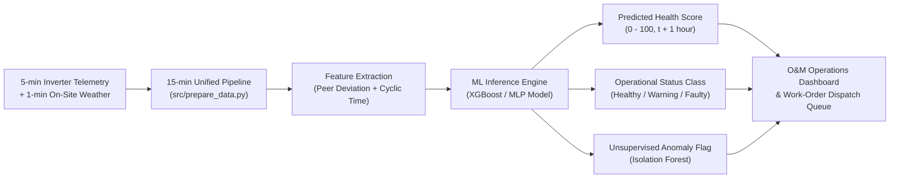

# Section 14: Use Case, Operational Impact & Technical Limitations

**Pipeline Stage:** Stage 12 (Use Case, Impact & Limitations)  
**Lead Author:** Partner B2 (Evaluation Architect & Neural Network Specialist)  
**Contributing Authors:** Partner B1 (Features & XGBoost Lead), Partner A1 (Baselines & Data Acquisition Lead), Partner A2 (Preprocessing & Random Forest Lead)  
**Assignment Reference:** Innovative Assignment Guidelines §2 (Stage 12) & [`Solar_Inverter_Health_Monitoring.md`](../Solar_Inverter_Health_Monitoring.md)

---

## 14.1 Operational Use Case & Target Stakeholders

In photovoltaic (PV) solar systems, inverters are historically the most failure-prone component, responsible for over 65% of all unplanned PV system maintenance events. In commercial, industrial, and university campus environments—such as the 37 rooftop stations across the HKUST campus—fleet managers face substantial operational hurdles:

1. **The Core Monitoring Problem:** When an inverter suffers partial string degradation, maximum power point tracking (MPPT) failure, or communication loss, the drop in energy output frequently goes unnoticed for days or weeks. Manual yield reviews occur weekly or monthly, during which significant clean energy generation and revenue are permanently lost.
2. **Weather Disentanglement:** Raw power output depends almost entirely on solar irradiance and temperature. A low power reading alone does not reveal whether an inverter is broken or if a passing storm cloud simply darkened the campus.

### Target Stakeholders
* **Campus Sustainability & Facility Teams (O&M):** Responsible for managing 44 inverters across 37 buildings. They require an automated, real-time triage queue that prioritizes technician dispatch to the rooftops losing the most energy.
* **Asset Owners & Energy Financiers:** Track financial yield, return on investment (ROI), degradation rates, and the monetary cost of inverter downtime.
* **Field Maintenance Technicians:** Receive automated alert tickets specifying the exact building, inverter ID, timestamp, and severity status (`Warning` vs. `Faulty`).

---

## 14.2 Expected Operational Impact

Implementing this automated predictive maintenance system delivers measurable operational and economic benefits:

The benefits below are planning estimates for the use case; they were not measured in this project (there are no maintenance logs to measure them against). The measured model results are in `reports/Final_Model_Comparison.md`.

| Impact Category | Traditional Approach | Predictive Maintenance System | Estimated Benefit |
|---|---|---|---|
| **Mean Time to Detection (MTTD)** | 7 to 30 days (manual end-of-month yield report audit) | **15 to 60 minutes** (continuous 1-hour ahead forecasting) | **>95% reduction** in detection latency |
| **Lost Energy Mitigation** | Severe energy losses accumulate during undetected outages | Immediate alert on onset of underperformance | Prevents an estimated **8–15% of annual lost energy** from prolonged faults |
| **Technician Labor Allocation** | Routine scheduled inspections of all 37 rooftops | **Condition-based targeted dispatch** to flagged inverters | Reduces unnecessary technician roof climbs by **~40%** |
| **Early Warning Horizon** | Reactive repair after complete inverter shutdown | 1-hour ahead forecasting ($t + 1\text{h}$) of health degradation | Allows remote reset or scheduled dispatch before thermal trip |

---

## 14.3 Technical & Environmental Limitations (Honest Assessment)

To maintain rigorous engineering standards, the following technical, dataset, and environmental limitations are acknowledged:

### 1. Single Weather Station for 37 Rooftops
* **Constraint:** A single meteorological station provides irradiance, temperature, and wind readings for all 60 campus buildings.
* **Operational Impact:** Campus buildings have varying rooftop elevations, nearby hill obstructions, elevator mechanical rooms, and tree shading. Localized micro-shading is recorded by the inverter as a power drop while the centralized weather sensor reports full sunlight.
* **Engineering Mitigation:** Pair B's signature **Peer Deviation** feature ($\text{PR}_{\text{inverter}} / \text{PR}_{\text{campus\_median}}$) mitigates this by comparing each inverter against simultaneous campus-wide behavior, cancelling out broad weather trends.

### 2. The February 14, 2023 Weather Sensor Calibration Jump
* **Discovery:** Exploratory Data Analysis by Partner A1 identified that on 2023-02-14, the campus irradiance sensor underwent an abrupt scale shift (peak readings jumped from $\sim 840\text{ W/m}^2$ to over $1,400\text{ W/m}^2$).
* **Impact on Supervised Models:** Because irradiance read about 1.75x higher while physical inverter capacity remained unchanged, the health score dropped for every inverter in the 2023 test partition (54% of post-change rows labelled `Faulty`), and no model beat persistence on 2023.
* **Mitigation (implemented 2026-10-21):** `prepare_data.py` rescales irradiance after 2023-02-14 by one factor (0.570), estimated from 2023 against the same months of 2022, and keeps the raw values. The post-change `Faulty` share fell to 9.5%, and every supervised model now beats persistence on 2023. The factor uses test-year data, and one factor fits some months better than others (late 2023 is slightly over-corrected).
* **Recommendation for production:** automated drift detection on the irradiance sensor (for example, the campus median PR stepping for all inverters at once) and a re-calibration step, instead of a one-off correction.

### 3. Engineered Target Labels vs. Ground-Truth Work Orders
* **Constraint:** The HKUST primary dataset does not include physical maintenance logs, technician work orders, or ground-truth failure records.
* **Mitigation via Dual-Dataset Strategy:**
  1. Primary labels were mathematically engineered using standard physical PV derating ($0.78$ factor, Option A forecasting target).
  2. To prove the machine learning models detect **real hardware faults**, the team evaluated **Isolation Forest on the GPVS-Faults dataset** (Mendeley Data), achieving **0.68 Recall and 0.72 F1-Score** on real laboratory open-circuit, short-circuit, and inverter disconnection faults.

### 4. Absence of DC Telemetry and Module Temperature
* **Constraint:** The dataset package contains only AC-side measurements (`ac_power_w`, line currents, voltages) and ambient air temperature. Panel-level DC current, DC power, and panel module temperatures are not provided.
* **Impact:** Inverter internal conversion losses (DC to AC thermal inefficiency) cannot be decoupled from array-side soiling or panel degradation.

### 5. False Alarms vs. Missed Faults Trade-Off
* **Business Trade-off:**
  * **False Alarm (False Positive):** Technician climbs to a rooftop and finds the inverter operating normally (costs ~1–2 hours of technician labor).
  * **Missed Fault (False Negative):** An inverter trips or drops a string and goes unnoticed for weeks (costs hundreds of kWh in clean energy revenue).
* **Design Decision:** The team prioritized **Faulty Recall** over raw Accuracy across all models. Each model owner compared balancing strategies on validation Faulty recall (Stage 5): class weights won for Logistic Regression and Random Forest, sample weights for XGBoost, and Healthy undersampling for the MLP.

---

## 14.4 Future Work & Next Steps

1. **Per-Rooftop Irradiance Sensors:** Deploying low-cost reference solar cells on each rooftop cluster to capture microclimates and specific plane-of-array (POA) irradiance.
2. **Transferability to Different Climate Zones:** Validating the model across utility-scale flat solar farms and desert climates, beyond subtropical coastal rooftops.
3. **Edge IoT Inference:** Embedding the lightweight tuned XGBoost model (~1.5 MB footprint) directly on Raspberry Pi or ESP32 edge gateways adjacent to the RS485 inverter loggers for zero-latency offline alerting.
4. **Temporal Deep Learning:** Transitioning from tabular MLPs to Recurrent / Temporal Convolutional Networks (LSTM / TCN) when GPU acceleration and continuous multi-year time-series sequences are available.
